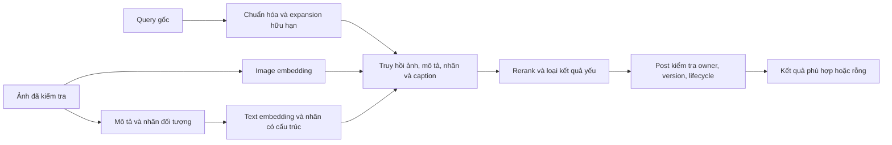

# Đánh giá chất lượng tìm kiếm kỷ niệm

Ngày: 2026-11-17. Phạm vi: đo trên dữ liệu cục bộ, đọc source và đề xuất nâng cấp.
Chưa thay thuật toán, model, cấu hình, schema hoặc chỉ mục đang chạy.

## 1. Kết quả kiểm tra thực tế

Đợt khôi phục trước xác nhận luồng embedding hoạt động và hai truy vấn chó/mèo
trả ảnh đúng ở đầu. Các kiểm thử đó không phải nghiệm thu chất lượng tổng quát.

Tập đang kiểm tra có 13 ảnh active/ready của một owner; Qdrant có 13 vector
khác nhau, 768 chiều, norm gần 1. Các phép đo dưới đây lọc đúng owner/profile;
vector-only dùng exact search, không có sai số tìm kiếm ANN trong phép đo này.

Đã xem ảnh thật qua API: ảnh `bicycle` là xe đạp; ảnh `other` là cầu thủ mặc
trang phục xanh; ảnh `soccer` trong seed chỉ thấy chân/giày đặt lên bóng.
Hai ảnh bóng đá này phải được gán nhãn riêng khi đánh giá.

| Truy vấn | Ảnh mong đợi | Hạng vector-only | Hạng API hybrid | Nhận xét |
| --- | --- | ---: | ---: | --- |
| người | Cầu thủ (`other`) | 9 | 10 | Vector-only đưa cà phê lên đầu; API đưa ảnh giày/bóng lên đầu |
| xe | Xe đạp | 3 | 3 | Hoa thứ 1, cà phê thứ 2 |
| cầu thủ bóng đá | Cầu thủ (`other`) | 1 | Chưa đo | Ảnh giày/bóng thứ 2 |
| xe đạp | Xe đạp | 1 | Chưa đo | Cách diễn đạt cụ thể cải thiện rõ trên mẫu này |
| phương tiện giao thông | Xe đạp | 1 | Chưa đo | Hỗ trợ giả thuyết chuẩn hóa khái niệm rộng |
| ảnh có người | Cầu thủ (`other`) | 13 | Chưa đo | Thêm tiền tố chung chung chưa cải thiện |

Truy vấn `xe`, cosine thực đo:

| Ảnh | Điểm |
| --- | ---: |
| Hoa | 0.592179 |
| Cà phê | 0.591409 |
| Xe đạp | 0.587615 |

Vì điểm ảnh sai cao hơn ảnh đúng, không tồn tại một ngưỡng cosine tối thiểu có
thể vừa giữ xe đạp vừa loại hai ảnh phía trên cho truy vấn này. Ngưỡng vẫn cần
cho loại kết quả yếu, nhưng không thay được bước cải thiện relevance/ranking.
Cosine không phải xác suất ảnh phù hợp.

Đối chứng bỏ `task: search result | query:` (giữ nguyên vector ảnh): `người`
đưa cầu thủ lên hạng 8 nhưng đầu bảng là chó/mèo; `xe` vẫn đưa xe đạp hạng 3,
sau cà phê/đàn guitar. Chưa có căn cứ bỏ task prefix như một bản sửa chất lượng.

Evidence cục bộ (ignored, không chứa credential):
`logs/moments-local/search-quality-api.json` và
`logs/moments-local/search-quality-vectors.json`. Đo 8 embedding văn bản thành
công (6 query-format hiện tại, 2 đối chứng plain); không tạo lại embedding ảnh.
Một lần chạy trong sandbox lỗi outbound và có reservation quota; các lần chạm
quota bị chặn trước provider. Không nới quota, không dùng khóa image enhancement.

## 2. Các điểm yếu đã xác nhận trong source

1. **Không có lớp khái niệm đối tượng.** `GeminiService.embed_query` chỉ bọc câu
   gốc bằng task prefix; chưa chuẩn hóa `xe` thành nhóm phương tiện, chưa có
   quan hệ `xe đạp -> phương tiện` hay `cầu thủ -> người` để hỗ trợ truy hồi.
2. **Trả hàng xóm gần nhất, chưa xác nhận phù hợp.** `QdrantService.search`
   không đặt `score_threshold`, không rerank; `MomentAiClient.search` lấy tối đa
   200 candidates. Trên tập 13 ảnh, cả `người` và `xe` trả đủ 13 ảnh.
3. **Điểm cosine bị bỏ trước khi đến Java.** Python chỉ trả asset/version;
   `MomentAiClient.Hit` cũng chỉ giữ hai trường này. Chưa có score/provenance
   để đo và hiệu chỉnh cách loại kết quả ở bước cuối.
4. **Nhánh metadata chưa xếp theo độ liên quan.** `MomentRepository.search`
   dùng substring `LIKE` trên caption/tags/place, sắp theo ngày mới nhất. Chưa
   có nhãn nội dung ảnh tự sinh hoặc phân cấp nhãn đối tượng.
5. **RRF cộng phiếu từ hai nguồn mà không kiểm tra nội dung lần nữa.** Caption
   ảnh giày/bóng chứa `người anh em`, nên ảnh này có cả metadata và vector vote.
   Với k=60 hiện tại, điểm của ảnh metadata #1 + vector #13 là
   `1/61 + 1/73 = 0.030092`, vượt ảnh chỉ vector #1 (`1/61 = 0.016393`).
   Đây là cơ chế fusion đang chạy, chưa phải thước đo relevance được hiệu chỉnh.

Nguồn code: `ai-service/app/services/{gemini_service,qdrant_service}.py`,
`post-service/src/main/java/com/loccoc/post_service/service/{MomentAiClient,MomentService}.java`,
`post-service/src/main/java/com/loccoc/post_service/repository/MomentRepository.java`.

## 3. Đề xuất theo thứ tự ưu tiên

### A. Tạo bộ đo và cải thiện query/ranking trước

- Giữ raw cosine, nguồn candidate và thứ hạng từng nhánh trong hợp đồng nội bộ;
  không trả vector, token hoặc dữ liệu tenant khác ra API public.
- Tạo regression cho các ảnh hiện có: người/cầu thủ, xe/xe đạp, chó/mèo, có dấu/
  không dấu, không có đáp án. Đánh giá riêng vector-only, metadata-only, hybrid.
- Với truy vấn một vài từ mang nghĩa nhóm đối tượng, thử ontology tiếng Việt có
  version: `xe -> phương tiện giao thông` cùng các loại con; `người -> person`
  cùng quan hệ vai trò/hoạt động. Giữ câu gốc và hợp nhất một số expansion hữu hạn,
  không thay `xe` chỉ bằng `xe đạp`, không áp dụng mở rộng vào câu phủ định.
- So sánh cách diễn đạt tiếng Việt/tiếng Anh trên tập có nhãn. Kết quả hiện tại
  mới chứng minh `phương tiện giao thông` tốt hơn `xe` trong tập nhỏ, chưa chứng
  minh dịch hoặc mở rộng mọi query sẽ tốt hơn.
- Nâng chất lượng nhánh text bằng relevance theo token/cụm/nhãn có trọng số,
  xử lý tiếng Việt có/không dấu; ngày chụp chỉ là tie-breaker. Thử RRF có trọng số
  hoặc bộ rerank dùng đặc trưng đã hiệu chỉnh; không cộng cosine trực tiếp với
  điểm text khác thang đo, không dùng RRF score như xác suất hoặc cosine.
- Tối ưu query-only có thể thử trên các vector hiện có; version query-format/
  cache-key và chạy shadow evaluation trước khi bật. Không đổi ngầm profile v1.

### B. Thêm mô tả và nhãn nội dung ảnh lúc ingest — nâng cấp chính được khuyến nghị

Sinh một mô tả ngắn bám sát những gì nhìn thấy, cùng nhãn đối tượng có cấu trúc,
tách biệt caption cảm xúc do người dùng nhập. Ví dụ xe đạp có object `bicycle`,
ancestor `vehicle`; cầu thủ có `person`, hoạt động thể thao khi đủ bằng chứng.
Ảnh chỉ có chân/giày cần ghi nhận người xuất hiện một phần, không ép cùng mức
liên quan với ảnh cầu thủ làm chủ thể chính.

- Dùng vision model phù hợp đã benchmark; lưu schema/model/prompt version và
  provenance. Mức tự tin model tự khai phải được kiểm chứng, không coi là xác suất.
- Tạo nhánh tìm theo visual tags và text embedding của mô tả ảnh, song song với
  image embedding hiện có. Chưa gộp user caption cảm xúc vào một vector duy nhất.
- Xử lý bất đồng bộ một lần/asset-version; cache kết quả theo phiên bản và chỉ
  backfill ảnh cũ có kiểm soát. Lỗi enrichment không làm mất ảnh hoặc image index.
- Post vẫn quyết định owner/lifecycle/version; AI chỉ trả enrichment dẫn xuất qua
  hợp đồng nội bộ. Không thay caption gốc hoặc dùng tên file làm nhãn đúng mặc định.
- Ngày/album/place vẫn là filter metadata có thẩm quyền. Với nhãn AI, ưu tiên boost
  khi chưa đủ độ tin cậy để hard-filter, tránh loại nhầm ảnh cần tìm.

Gemini có khả năng image captioning/classification và JSON Schema output;
chất lượng nhãn trên LocCoc cần đánh giá riêng. Tham khảo
[Image understanding](https://ai.google.dev/gemini-api/docs/image-understanding) và
[Structured outputs](https://ai.google.dev/gemini-api/docs/structured-output).

### C. Rerank và quyết định trả ít kết quả hoặc không có kết quả

Lấy một tập candidates hữu hạn từ các nhánh, rồi rerank theo câu hỏi và bằng
chứng trong ảnh/mô tả/nhãn. Có thể thử vision reranker trên top 10–20 ảnh cho
query khó; đây là phạm vi thử nghiệm, cần đo chi phí/độ trễ trước khi triển khai.
Không dùng text-only reranker để tuyên bố đã kiểm chứng nội dung pixel.

Hiệu chỉnh ngưỡng giữ/loại ở đầu ra bằng tập validation có cả ảnh liên quan và
hard negatives/no-answer. Cho phép trả ít hơn limit hoặc rỗng. Không chọn ngưỡng
0.6 hay 0.7 chỉ từ vài cosine trong báo cáo này. Cache/limit theo owner và version;
vẫn kiểm tra lại quyền, trạng thái và phiên bản trước khi trả ảnh.

### D. So sánh model/dimension sau khi có baseline

Chạy đối chứng 768/1536/3072 trên cùng tập có nhãn nếu các bước trên chưa đạt.
Không có bằng chứng hiện tại rằng tăng dimension sẽ sửa hai lỗi này. Nếu đổi
embedding profile ảnh, tạo collection mới/backfill có kiểm soát, có đường rollback.
Không cần đổi Qdrant để xử lý vấn đề relevance đã đo được.

## 4. Kiến trúc mục tiêu

## 5. Tiêu chí đánh giá trước khi bật

- Bộ 13 ảnh là regression smoke, không đủ đại diện chất lượng sản phẩm. Trước
  hết mở rộng tập thăm dò đa dạng; nghiệm thu theo kế hoạch hiện có với ít nhất
  1.000 ảnh/200 query có nhãn relevance và tập validation/test tách biệt.
- Query cụ thể cần ảnh đúng đứng đầu; query nhóm như `người`, `xe` cần các ảnh
  đúng nằm ở top cao và không bị hoa/cà phê chiếm chỗ. Chốt qrels cho trường hợp
  người xuất hiện một phần, chủ thể chính/phụ và phủ định trước khi tune.
- Đo Precision@3, nDCG@10, Recall@10 và tỷ lệ trả nhầm cho no-answer; giữ bộ
  chó/mèo để phát hiện regression. Đo thêm latency, provider calls/query và
  chi phí enrichment/ảnh; không nghiệm thu bằng số lượng kết quả trả về.
- Chạy cùng owner/date/album filters và final ACL; so các phương án trên cùng
  corpus, không tune và báo điểm trên chính tập test đã dùng để chọn tham số.

## 6. Đối chiếu tài liệu chính thức

- [Gemini embeddings](https://ai.google.dev/gemini-api/docs/embeddings): query
  task-format, multimodal embedding, output dimensions. Task prefix hiện tại
  khớp mẫu retrieval được tài liệu nêu; không phải lỗi cú pháp đã xác nhận.
- [Qdrant hybrid/multi-stage search](https://qdrant.tech/documentation/search/hybrid-queries/):
  RRF kết hợp theo vị trí, có thể truy hồi rồi xếp lại nhiều tầng.
- [Qdrant score filtering](https://qdrant.tech/documentation/search/search/#filtering-results-by-score):
  hỗ trợ `score_threshold`, cần biết điểm chấp nhận cho model/metric cụ thể.

Khuyến nghị thực hiện A trước để có baseline và sửa query/ranking có thể đo được,
sau đó B là bước nâng cấp chính cho nhận biết nhóm đối tượng, C để tăng precision.
D chỉ thực hiện khi phép đo cho thấy giới hạn còn lại thuộc embedding model.
