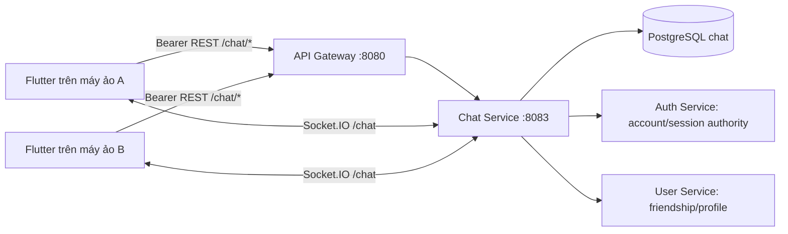

# Thiết kế chat realtime 1–1

Ngày: 2026-11-13. Trạng thái: **Đề xuất để duyệt; chưa triển khai backend hoặc màn hình chat**.

Người dùng đã chọn tích hợp đăng nhập thật từ `main` vào nhánh local `chat-service`. Phạm vi 1–1, các thông số dưới đây và lựa chọn Socket.IO là đề xuất của agent; không suy diễn thành yêu cầu đã được duyệt.

## 1. Mục tiêu và nền hiện có

Hai tài khoản thật, đăng nhập trên hai máy ảo khác nhau, có thể bắt đầu hội thoại, gửi/nhận văn bản ngay khi cả hai đang kết nối, xem lại lịch sử sau khi mở app và nhận trạng thái đã đọc/đang nhập.

Tái sử dụng [AuthSession](../../../MobileApp/lib/features/auth/domain/models/auth_session.dart), [UserApiClient](../../../MobileApp/lib/features/users/data/user_api_client.dart), luồng refresh/logout hiện có và [AccountAuthorityClient](../../../libs/common/src/security/account-authority.client.ts). User ID trong chat là account ID UUID của Auth Service, cũng là khóa profile User Service. Không tạo hệ thống đăng nhập hay danh tính demo cho chat.

Giai đoạn đầu chỉ có một instance Chat Service. Chưa gồm chat nhóm, ảnh/file/voice, cuộc gọi, sửa/xóa tin nhắn, push khi app đóng, tìm kiếm toàn văn, E2EE hoặc nhiều replica. Trạng thái kết nối chỉ phản ánh kết nối của app; không hiển thị một dấu online giả cho người nhận.

## 2. Các hướng đã cân nhắc

| Hướng | Đánh đổi | Kết luận |
| --- | --- | --- |
| Dùng đăng nhập và bạn bè từ main | Phải tích hợp các thay đổi gateway/config, nhưng dùng account/session thật và dễ phát triển tiếp | Người dùng đã chọn |
| MVP độc lập với danh tính test | Ít phụ thuộc lúc demo, nhưng phải làm lại tích hợp danh tính | Không chọn |

Đề xuất kỹ thuật: NestJS + PostgreSQL riêng cho chat, REST cho thao tác bền vững và Socket.IO 4 cho cập nhật realtime. REST giữ một đường ghi dữ liệu; socket chỉ truyền thông báo và trạng thái đang nhập. Flutter dùng client Socket.IO tương thích phiên bản server. Không dùng polling định kỳ để giả realtime.

Socket.IO mặc định không đảm bảo phục hồi mọi sự kiện đã bỏ lỡ; vì vậy lịch sử trong database và REST resync là nguồn dữ liệu chính. Tham khảo [delivery guarantees](https://socket.io/docs/v4/delivery-guarantees/) và [Dart client](https://pub.dev/packages/socket_io_client).

## 3. Kiến trúc và xác thực

- REST đi qua Nest gateway với prefix `/chat`; Chat Service vẫn kiểm tra Bearer token nếu bị gọi trực tiếp. Không tin `senderId`, `x-user-id` hoặc tên room do client tự khai.
- Socket dùng namespace `/chat`, Engine.IO path `/socket.io`, cùng HTTP server port `8083`; handshake nhận `auth.accessToken`. Server xác định account bằng `AccountAuthorityClient.access` và quản lý danh sách socket theo account đó.
- Socket kết nối trực tiếp Chat Service khi test local vì proxy HTTP `fetch` hiện tại không xử lý HTTP Upgrade. Flutter có `CHAT_SOCKET_URL` riêng; không tự suy ra rằng gateway đã hỗ trợ WebSocket. Production cần ingress hỗ trợ WebSocket và TLS; nhiều replica cần bổ sung adapter/broker, ngoài phạm vi đợt này.
- Kiểm tra account/session ở mỗi REST command, mỗi event từ client và trước khi chuyển một event đến socket nhận. Nếu Auth Service không xác minh được, dừng thao tác và trả lỗi dịch vụ; không chuyển sang danh tính giả hoặc cho phép theo cache cũ.
- Khi token hết hạn/phiên bị thu hồi, client đóng socket. Nếu còn refresh session hợp lệ, dùng luồng refresh chung một lần, nối lại socket bằng token mới rồi resync. Logout/chuyển tài khoản phải hủy listener, timer và socket cũ trước khi hiện tài khoản mới.
- Chỉ bạn bè có `relationshipStatus === 'FRIENDS'` mới bắt đầu hoặc tiếp tục tương tác chat. Kiểm tra qua `GET /users/profiles/:peerId` với Bearer thật, timeout 5 giây; User Service đã kiểm tra trạng thái account và block hai chiều. Không đọc trực tiếp database User Service.
- Sau unfriend/block hoặc account không còn khả dụng, không gửi/typing/read/broadcast mới; UI hiển thị trạng thái không thể tiếp tục hội thoại. Lịch sử đã có của participant vẫn đọc được để không làm mất dữ liệu cục bộ; response lịch sử không công bố profile mới của người đã block. Quyền participant vẫn bắt buộc.
- Quyết định của agent sau builder review: quan hệ thay đổi được phát hiện khi có thao tác, trước khi phát event hoặc khi resync/resume. Một màn hình đang idle không được hứa sẽ đổi ngay sau khi người kia block ở nơi khác; cập nhật tức thời lúc idle cần cơ chế relationship invalidation riêng, ngoài đợt này.
- Hạn mức đề xuất tại Chat Service: 30 lần gửi/phút/account, tối đa 5 socket/account, 1 typing update/giây/socket. Giữ limiter HTTP gateway hiện có. Một tiến trình ban đầu có thể giữ bộ đếm trong RAM; ghi rõ reset khi restart, chưa phải hạn mức phân tán.

## 4. Dữ liệu và tính nhất quán

Database riêng `chat`, role riêng `chat_service`; TypeORM migration, không dùng `synchronize`. Tạo database/role cho volume mới và cung cấp lệnh khởi tạo bổ sung cho volume đã có; không xóa volume để nâng cấp.

| Bảng | Nội dung / ràng buộc |
| --- | --- |
| `conversations` | UUID, `user_low_id`, `user_high_id`, `last_sequence`, `created_at`, `updated_at`; CHECK hai account khác nhau, UNIQUE cặp UUID đã sắp xếp |
| `conversation_members` | `(conversation_id, account_id)` duy nhất, `last_read_sequence` ban đầu 0; đúng hai thành viên khi tạo conversation |
| `messages` | UUID, conversation, sender, `client_message_id`, sequence, text, server timestamp; UNIQUE `(sender_id, client_message_id)` và `(conversation_id, sequence)` |

Tạo/mở cùng cặp account đồng thời trả cùng conversation, kể cả khi hai bên cùng bấm bắt đầu. Trong transaction gửi tin: kiểm tra participant, tăng `last_sequence`, lưu message và cập nhật conversation. Chỉ phát `message:new` sau commit.

`text` được trim, không cho toàn khoảng trắng, dài 1–2000 Unicode code point; cả Dart và backend kiểm tra cùng cách đếm. `clientMessageId` là UUID mới cho một tin do client tạo. Retry giữ nguyên UUID và nội dung; trả lại message đã có. Cùng UUID nhưng khác conversation/nội dung trả `409 MESSAGE_ID_CONFLICT`. Không tự gửi lại một yêu cầu có kết quả chưa rõ với UUID mới.

Sequence bigint truyền dưới dạng chuỗi số thập phân trong JSON để tránh mất chính xác. Thứ tự chuẩn là sequence server, không dùng đồng hồ thiết bị. Cursor lịch sử là sequence đã validate và chỉ có ý nghĩa trong conversation được cấp quyền.

`last_read_sequence` chỉ tăng bằng giá trị lớn hơn hiện tại và không vượt một message thực sự của conversation. Unread chỉ đếm tin của người còn lại sau read cursor. Không đánh dấu đã đọc khi tin chỉ đến socket mà màn hình chưa được mở/resumed.

Nếu tiến trình dừng giữa commit và emit, message vẫn nằm trong database. Client resync lịch sử/danh sách khi reconnect hoặc app resumed, merge theo message ID và `clientMessageId`; không hứa socket phát đúng một lần. Không cần transactional outbox trong phiên bản một instance này.

## 5. Hợp đồng HTTP và socket đề xuất

REST trả thời gian ISO 8601 UTC, UUID cho ID, lỗi theo exception filter chung có `statusCode`, `error`, `message`, `requestId` và `code` nếu có. Không trả token hay nội dung lỗi từ dependency.

| Method / path | Request / response chính |
| --- | --- |
| `GET /health` trực tiếp port 8083 | Liveness, không cần token; không thay thế readiness DB |
| `POST /chat/conversations/direct` | `{ peerId }` → `{ conversation }`, status 200 khi mở mới hoặc đã có |
| `GET /chat/conversations` | `{ data, nextCursor }`; limit mặc định 20, tối đa 50; sắp theo updatedAt/ID giảm dần; cursor encode cặp timestamp/ID, validate trước query |
| `GET /chat/conversations/:id` | `{ conversation }`; xác minh participant; dùng lấy lại quyền tương tác và read cursors lúc mở detail/reconnect |
| `GET /chat/conversations/:id/messages` | `before` để lấy cũ hơn hoặc `after` để resync; không nhận đồng thời; limit mặc định 25, tối đa 100; response `{ data, hasMore }` theo sequence tăng dần |
| `POST /chat/conversations/:id/messages` | `{ clientMessageId, text }` → `{ message }`, status 200 cho cả gửi mới và retry hợp lệ |
| `PATCH /chat/conversations/:id/read` | `{ sequence }` → `{ lastReadSequence, unreadCount }` |

Conversation response có `id`, `peer: { id, username, displayName, avatarUrl }` (nullable khi không còn khả dụng), `canInteract`, `lastMessage`, `unreadCount`, `lastReadSequence`, `peerLastReadSequence`, `updatedAt`. Read sequences là chuỗi số thập phân, ban đầu `"0"`. Message có `id`, `conversationId`, `senderId`, `clientMessageId`, `sequence`, `text`, `createdAt`.

Quyết định của agent sau builder review: reconnect/resume tải conversation detail và hợp nhất cả hai read cursor bằng giá trị lớn hơn đã biết. Vì vậy event `conversation:read` bị lỡ vẫn phục hồi được; bubble gửi của mình được đánh dấu đã đọc khi sequence không lớn hơn `peerLastReadSequence`.

Socket không cung cấp API join room tùy ý. Server tự gắn socket với account đã xác minh. Mọi event có `conversationId`; chỉ gửi tới thành viên tương ứng.

| Chiều | Event | Payload |
| --- | --- | --- |
| Server → client | `message:new` | `{ message }` |
| Server → client | `conversation:updated` | `{ conversationId }`; client làm mới inbox có debounce |
| Client → server | `typing:update` | `{ conversationId, isTyping }`; server xác minh participant và quan hệ bạn bè |
| Server → client | `typing:updated` | `{ conversationId, accountId, isTyping }`; tự hết hạn sau 3 giây |
| Server → client | `conversation:read` | `{ conversationId, accountId, sequence }` |
| Server → client | `chat:error` | `{ code, message }`; không kèm stack/token/nội dung tin nhắn |

Không có `message:send` trên socket trong bản này: gửi qua REST, nhận event realtime. Client xử lý event có thể đến trước response POST bằng cách hợp nhất theo ID, không append mù.

## 6. Các màn hình Flutter

Giữ theme LocCoc và luồng đăng nhập/home của `main`. Thêm nút Tin nhắn ở Home dẫn tới inbox; chỉ bật với session thật.

1. **Danh sách hội thoại:** avatar/tên, tin cuối, giờ, unread badge, nút tạo hội thoại; loading, rỗng, lỗi và retry; nhãn mất kết nối có nội dung tiếng Việt.
2. **Chọn bạn để chat:** danh sách bạn bè từ API hiện có, lọc theo tên/username tại client trên dữ liệu đã tải và có load more; không tạo danh sách account giả. Chọn bạn → mở conversation duy nhất → detail.
3. **Chi tiết hội thoại:** header người nhận, bubble trái/phải, nhóm ngày/giờ, ô soạn nhiều dòng, nút gửi; pending/sent/failed và retry giữ UUID, chỉ báo đang nhập, đã đọc. Load more ở đầu lịch sử không làm nhảy vị trí đang đọc.

Composer không cho gửi rỗng hoặc khi đã mất quyền tương tác. Khi mất mạng vẫn giữ bản nháp; một tin đang chờ quá 10 giây hiện “Chưa xác nhận”, cho retry cùng ID. Người dùng có thể soạn tin khác; không khóa toàn màn hình. Dispose listener/focus/timer đúng lifecycle, tránh setState sau dispose và không đẩy người đọc về cuối khi họ đang xem tin cũ.

Code feature nằm dưới `MobileApp/lib/features/chat/{domain,data,presentation}`; `ChatApi` dùng `UserApiClient.request(area: 'chat')` để dùng lại refresh/session. Khi triển khai cần mở rộng allowlist `area` trong `AuthApiClient.serviceRequest` để nhận thêm đúng `chat`; hiện allowlist chỉ có `users`, `notifications`, `auth`. `ChatSocketClient` có URL và transport được inject cho test. State điều phối nằm trong controller riêng, không nhúng networking vào widget. UI fake repository chỉ dùng trong test.

## 7. Các mốc triển khai sau khi duyệt

| Mốc | Sản phẩm / tiêu chí |
| --- | --- |
| 1 | Chat Service, config riêng, DB migration và script chạy; build được, health hoạt động |
| 2 | HTTP conversation/message/read và policy bạn bè; test IDOR, idempotency, concurrency và persistence bằng PostgreSQL disposable |
| 3 | Socket xác thực, phát sau commit, typing/read; hai client socket nhận tin, resync không nhân đôi, logout không nhận event cũ |
| 4 | Flutter model/API/controller/socket và ba màn hình; widget/unit test cho happy/error/reconnect, bàn phím và session switch |
| 5 | Gateway route REST, OpenAPI, hoàn thiện runbook hai máy ảo, smoke test A ↔ B và ghi lại phần nào đã/chưa chạy thật |

Kế hoạch công việc chi tiết sẽ được tách thành file checklist sau khi thiết kế này được duyệt; đây chưa phải tuyên bố các mốc đã hoàn thành.

## 8. Kiểm thử chấp nhận

- A/B đăng nhập hai tài khoản active khác nhau, hoàn tất username và kết bạn. A mở chat B; B thấy tin mới khi foreground mà không refresh thủ công.
- Gửi hai chiều, nội dung tiếng Việt/emoji, nhiều dòng; giới hạn 2000 code point, chặn rỗng và field thừa.
- Retry cùng message ID tạo một message; event đến trước POST response không nhân đôi bubble.
- B offline trong lúc A gửi: database giữ tin; reconnect/resume tải đúng các tin bị lỡ. Restart backend vẫn còn lịch sử.
- Read cursor cũ đến sau cursor mới không làm unread tăng lại. Chỉ màn hình đang xem ở foreground đánh dấu đã đọc.
- B đọc trong lúc A offline; A reconnect tải `peerLastReadSequence` qua detail, vẫn thấy đúng trạng thái đã đọc dù bỏ lỡ socket event.
- Người C đoán conversation UUID không đọc/gửi/read/typing hoặc nhận event được; gửi `senderId` giả bị từ chối.
- Token hết hạn, logout-all, block/unfriend, đổi account và dependency không khả dụng có hành vi như mục 3; không phát event nhầm tài khoản.
- Mô tả rõ một instance và khả năng mất event socket khi tiến trình chết; REST resync phải phục hồi dữ liệu đã commit.
- Chạy build, unit, HTTP/socket integration, Flutter analyze/test; DB integration dùng instance disposable, không dùng hoặc xóa volume dữ liệu thật.

## 9. Tài liệu liên quan

- [ADR-012: lựa chọn realtime chat](../../adr/ADR-012-realtime-chat.md).
- [Hướng dẫn hai máy ảo](../../guides/chat-two-emulators.md), tách phần đăng nhập chạy được hiện tại với phần chat chờ triển khai.
