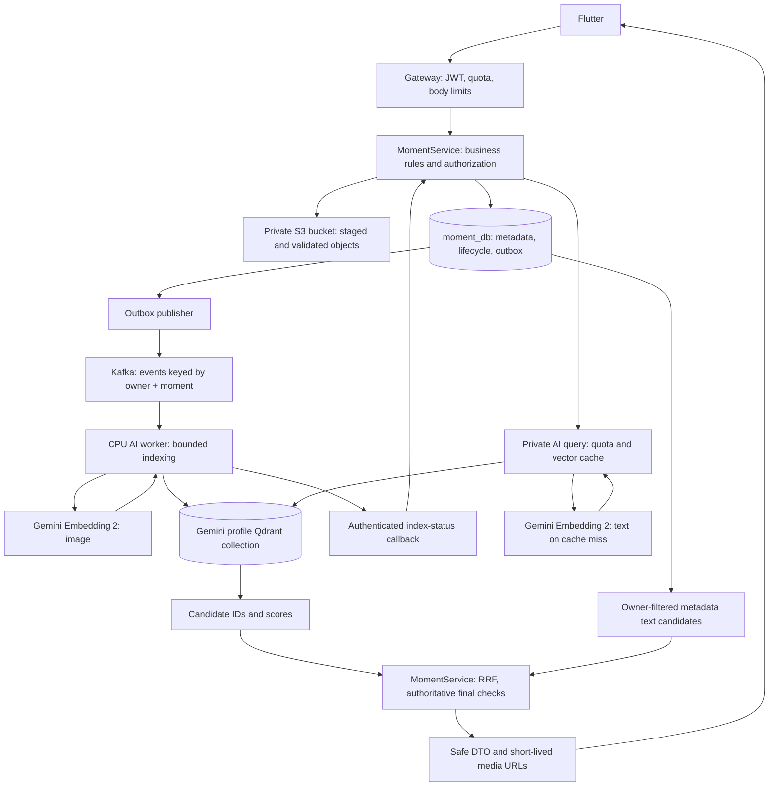

> Historical runtime document: the Nest Moments deployment is superseded by [Java Post/Moments](../unified-post-moments.md).

# Đánh giá và kế hoạch tìm kiếm khoảnh khắc thông minh

> Runtime implementation now exists under [ADR-016](../../adr/ADR-016-unified-ai-and-moment-runtime.md).
> The original assessment/test targets below remain reference material. Consult
> the [runtime report](reports/2026-11-14-runtime.md) and [operations](operations.md)
> for actual implemented contracts, evidence and unresolved rollout gates.

Ngày: 2026-11-14. Quyết định: [ADR-015](../../adr/ADR-015-smart-moment-search.md).
Phạm vi đợt này: cập nhật thiết kế Gemini API và kế hoạch sửa lỗi bằng Markdown;
chưa hiện thực tính năng/benchmark. Kế hoạch thực thi chi tiết và backlog nằm tại
[Gemini implementation and remediation](gemini-implementation-and-remediation-plan.md).
Lựa chọn SigLIP tự host ở phiên bản trước đã được thay bằng Gemini Embedding 2.

## 1. Đánh giá đề xuất được cung cấp

Đề xuất đúng về shared image/text embedding, xử lý tiếng Việt, lọc theo owner,
async ingestion và đo tải. Tuy nhiên tệp cung cấp là yêu cầu nghiên cứu, chưa có
kết quả chứng minh để coi là thiết kế sẵn sàng production.

| Nhận định/mục tiêu | Điều chỉnh phải thực hiện |
| --- | --- |
| Model đa ngữ sẽ hiểu tốt tiếng Việt | Đo riêng có dấu, không dấu, từ địa phương, câu dài và phủ định; không suy từ số ngôn ngữ hỗ trợ |
| MRL tiết kiệm 50–75% RAM | Chỉ đúng với phần raw vector khi giữ nguyên dtype và số vector; đo RSS/cache/HNSW riêng |
| Có filter userId là đủ cách ly | Owner phải từ authentication; chặn ghi đè point khác tenant, kiểm tra quyền cuối và bảo vệ file gốc |
| Similarity threshold loại hoàn toàn ảnh không liên quan | Không có một ngưỡng cosine bảo đảm điều này; hiệu chỉnh bằng validation/no-answer, kiểm tra trên tập giữ lại |
| 15–20 ảnh đủ xác nhận chất lượng | Chỉ đủ smoke test; cần tập ảnh thật đa dạng có quyền sử dụng và relevance labels |
| 100k vector ngẫu nhiên chứng minh độ chính xác | Chỉ kiểm tra sức chứa/tải, không chứng minh chất lượng ảnh thực hoặc filtered ANN recall |
| `<200ms` thời gian thực | Phải định nghĩa percentile, cache, warm/cold, hardware, tải và phạm vi đo |
| CLIP xử lý ảnh/video/media | PoC chỉ decode ảnh; video cần keyframe/segment, timestamp và cơ chế gộp kết quả riêng |
| “bé của tôi”, “người yêu”, “tuần trước” đều là semantic | Quan hệ cần nhãn do người dùng cung cấp; thời gian cần parser + capturedAt; không có dữ liệu thì không suy đoán |
| Model miễn phí tải về là dùng được cho sản phẩm | Quyết định mới dùng Gemini API Paid Services; kiểm tra điều khoản dữ liệu/đối tượng sử dụng, quota và giá trước rollout |

## 2. Kết quả rà soát source

Các số dòng dưới đây là snapshot lúc đánh giá; xem source nếu sau này có thay đổi.
Đã đối chiếu lại các đường code chính ngày 2026-11-14: PoC vẫn dùng Jina và các
vấn đề dưới đây chưa được sửa trong đợt cập nhật tài liệu. P0 biểu thị mức ưu tiên
chặn tích hợp; điều kiện tiếp cận service và tác động thực tế cần test cô lập.

| Mức độ | Vị trí | Phát hiện và tác động |
| --- | --- | --- |
| P0 | `ai-service-2/app/api/v1/endpoints/search.py:10`, `app/schemas/search.py:7`, `app/api/deps.py` | Không có auth dependency; caller tự chọn owner để đọc ảnh tenant khác nếu tiếp cận được service |
| P0 | `ai-service-2/app/api/v1/endpoints/media.py:16`, `app/services/qdrant_service.py:66` | Caller chọn cả media_id/user_id; point ID không chứa tenant, có thể ghi đè/chuyển owner điểm đã tồn tại |
| P0 | `ai-service-2/app/api/v1/endpoints/media.py:35` | Fetch URL tùy ý dẫn tới SSRF; timeout 15s không thay thế allowlist/storage-key policy hoặc giới hạn response |
| P0 khi dùng cho moments | `docs/adr/ADR-014-profile-media.md`, `user-service/src/media/media.storage.ts` | Profile media có public origin; không dùng mô hình công khai này cho khoảnh khắc riêng tư |
| P1 | `ai-service-2/app/api/v1/endpoints/media.py:30`, `embeddings.py:35` | Đọc toàn bộ file, thiếu giới hạn ứng dụng và chính sách decode đầy đủ; chưa kế thừa kiểm tra đã có ở UserService |
| P1 | `ai-service-2/app/api/v1/endpoints/search.py:17`, `media.py:48` | Gọi inference đồng bộ trong async handler; Qdrant sync cũng chặn event loop. Async keyword không tạo GPU scheduling |
| P1 | `ai-service-2/app/api/v1/endpoints/health.py:18`, `app/services/jina_service.py:29` | Health luôn healthy; model lazy-load khiến request đầu tải/nạp model. Readiness chưa kiểm tra shape/collection/inference |
| P1 | `ai-service-2/app/services/qdrant_service.py:18` | Collection có sẵn chưa kiểm tra dimension/distance/index; lỗi bị nuốt; payload index chỉ tạo lúc tạo collection |
| P1 | `ai-service-2/app/services/qdrant_service.py:33` | memmap_threshold là ngưỡng dung lượng vector theo segment, không phải số ảnh; comment hiện tại dễ gây hiểu nhầm |
| P1 | `ai-service-2/app/services/qdrant_service.py:88` | Chưa có range filter capturedAt, version/tombstone, delete/reconciliation hoặc final authority check |
| P1 | `ai-service-2/app/services/jina_service.py:39`, `requirements.txt`, `compose.yaml` | Chưa pin remote code/model revision, dependencies và image Qdrant; chưa có kiểm tra supply chain tái lập |
| P1 | `api-gateway/src/service-proxy.controller.ts:112`, `ai-service-2/app/main.py:51` | Nest giữ prefix /ai trong khi FastAPI dùng /api/v1; Spring properties chưa có AI route |
| P1 | `ai-service-2/scripts/test_search.py:14` | Một ảnh vẽ và output console không đủ benchmark; nhiều lỗi vẫn kết thúc tiến trình thành công |
| P2 | `ai-service-2/app/schemas/embedding.py:5`, `app/schemas/search.py:5`, endpoint exception handlers | Chưa bound text/batch/dim, trả raw exception/payload; cần DTO và lỗi public được allowlist |

Không phát HTTP khai thác vào dữ liệu thật. Các phát hiện trên là phân tích source,
không phải kết quả penetration test. Không đọc hoặc thay đổi `.env`/secrets.

## 3. Luồng và ranh giới dữ liệu đã chọn

`moment-service` sở hữu owner, albums nếu hỗ trợ, capturedAt, caption/tags/place,
media object ledger, version, deletion state và outbox trong database riêng.
Không JOIN trực tiếp `user_db`/`auth_db`; dùng cơ chế JWT/account authority hiện có
qua hợp đồng nội bộ. AI sở hữu adapter API và chỉ mục dẫn xuất, không quyết định ACL.
Chính sách tài khoản khóa/xóa phải được kiểm tra cả khi truy cập service trực tiếp.
Gemini chỉ nhận derivative/query cần thiết; owner/account/ACL vẫn ở hạ tầng LocCoc.

API public dự kiến: tạo metadata moment; PUT binary ảnh vào moment draft của chính
chủ; GET/DELETE theo ID; `POST /moments/search`. Search DTO gồm query, albumId,
capturedFrom/To, location và limit hữu hạn. Không nhận owner/raw vector filter/
client score threshold. Search route không được bị dynamic `/:id` route che khuất.
Hai Gateway phải có route, quota và kiểm thử truyền body cho hợp đồng mới.

Upload hoàn tất sau khi có processed object và transaction metadata/outbox commit;
đáp ứng `201` cùng `indexStatus=pending`. Draft không có ảnh hợp lệ không được
xuất hiện trong tìm kiếm. Không giữ DB transaction trong lúc decode hoặc chờ S3.
S3/DB thất bại phải bảo toàn dữ liệu cũ; staged objects có ledger và cleanup TTL.
Ảnh giữ tỷ lệ/nội dung, áp dụng orientation, strip metadata và sinh thumbnail;
capturedAt/GPS chỉ được ghi làm metadata theo lựa chọn người dùng trước khi strip.
Không tự thu thập EXIF location. Bộ đếm quota/storage dựa trên dữ liệu có thẩm quyền.

### Cách ly và vòng đời

- Authenticated owner bắt buộc trên mọi query/index/read/delete/status. Internal
  service identity được kiểm tra; private network không thay thế authentication.
- Backend cấp ID; định danh point từ owner + moment + asset/version theo chiến
  lược đã kiểm thử. Không dùng ID file/client tự chọn làm khóa toàn cục.
- Worker nhận object key đã xác minh qua hợp đồng nội bộ, dùng quyền chỉ đọc đúng
  bucket; không fetch URL client. Byte/pixel/decode deadline và concurrency hữu hạn.
- Giao sự kiện at-least-once; dedupe theo eventId, key Kafka theo aggregate;
  retry exponential backoff + jitter hữu hạn, DLQ có owner/runbook/replay.
- Serialize index/delete theo aggregate hoặc lease có fencing; version không được
  lùi. Event/job cũ không được đánh dấu phiên bản mới ready. Tombstone và kiểm tra
  lại trước/sau xử lý cùng reconciliation dọn stale points. Chỉ payload version
  hoặc UUID ổn định tự nó không giải quyết race giữa các consumer.
- Mọi kết quả vector và text đều được MomentService kiểm tra lại owner, active
  account, deletedAt, asset/version, album/date/place trước khi hydrate hoặc ký URL.
  Overfetch hữu hạn và refill nếu còn ngân sách; không hứa luôn đủ K khi bị loại.
- Xóa: PostgreSQL đánh dấu xóa và ghi outbox atomically; ngừng trả kết quả/cấp URL
  ngay ở source of truth, sau đó xóa object/vector bằng worker có retry. Account
  deletion phải áp dụng cùng cơ chế. Cache/cursor gắn owner và version/expiry.
- Presigned URL dự kiến TTL 60 giây; URL đã cấp và bytes đã tải không thu hồi tức
  thời được. Nếu sản phẩm cần kiểm tra quyền từng lần đọc, dùng authenticated
  streaming media endpoint thay cho bearer URL. Không tuyên bố ACL tuyệt đối khi
  đã phát URL có hạn hoặc client đã lưu bản sao.

### Truy vấn tiếng Việt và metadata

Giữ câu gốc Unicode NFC cho model; text metadata có bản chuẩn hóa không dấu và
alias có kiểm soát, không tự thay toàn bộ câu embedding thành không dấu. Không
dùng dịch tiếng Anh/LLM ngoài hệ thống mặc định vì thêm latency và gửi dữ liệu ra
ngoài. Model token budget phải được kiểm tra bằng tokenizer, không cắt im lặng.

Parser giai đoạn đầu chỉ nhận mẫu thời gian/địa điểm đã xác định rõ; trả
`appliedFilters` cho UI. Filter người dùng chọn được ưu tiên; mâu thuẫn cần phản
hồi validation/clarification thay vì tự chọn một bên. Câu mơ hồ giữ semantic text,
không tự tạo hard filter thiếu căn cứ. capturedAt không có thì không khớp date
filter; thời điểm upload là trường khác. Dùng khoảng nửa mở `[from,to)` theo múi
giờ người dùng rồi chuyển UTC. Clock/timezone được đóng băng trong tests.

Ví dụ tại 2026-11-14, Asia/Bangkok, “tháng trước” là tháng 10:
`[2026-09-30T17:00:00Z, 2026-10-31T17:00:00Z)`. “Đà Nẵng” phải dựa vào metadata
location/alias, không dựa vào khả năng model đoán bối cảnh. “Ấm cúng” là relevance
mềm; không thể kiểm thử như điều kiện chính xác tuyệt đối. Caption do người dùng
nhập có thể hỗ trợ “con tôi”; mặc định không làm face recognition.

## 4. Embedding profile, vector và vận hành API

Một collection cho mỗi embedding profile (provider/model + preprocessing + dimension/schema version),
không một collection/user. Payload tối thiểu: ownerId, momentId, assetId,
assetVersion, albumId, capturedAt, locationId nếu có. ownerId keyword tenant index,
albumId/locationId keyword và capturedAt datetime index. Khởi động phải kiểm tra
collection/index đã tồn tại đúng schema; sai thì readiness fail, không nuốt lỗi.
Không trả nguyên payload Qdrant cho Flutter.

| Cấu hình | Raw float32 / 100k vector | Cách sử dụng |
| --- | --- | --- |
| Gemini 768 | 293.0 MiB | Mặc định MVP, cosine; kiểm tra shape/finite/norm |
| Gemini 1536 | 585.9 MiB | Đối chứng khi cần cải thiện chất lượng trong budget |
| Gemini 3072 | 1171.9 MiB | Đối chứng, không mặc định trả chi phí RAM cao hơn |

Công thức `N * dimension * 4 / 2^20`, một vector/ảnh; chưa gồm HNSW, payload,
segments, page cache, replicas/snapshot, staging hoặc model weights/activations.
Giảm dimension giảm dung lượng vector; không mặc định giảm phí API theo cùng tỷ lệ.

Đo hai preset Qdrant in-memory và on-disk/mmap trên SSD với cùng dataset/filter.
Ở 100k ảnh chưa có căn cứ bắt buộc offload mọi thứ xuống disk hoặc quantize;
chọn in-memory nếu nằm trong ngân sách, bật on-disk khi phép đo RAM/tail latency
cho thấy phù hợp. Ghi cả cold/warm page cache và trạng thái indexing/optimization;
không mặc định tất cả segment đã chạy HNSW. Khóa phiên bản server/client và dùng
cấu hình storage đúng phiên bản đã test; không diễn giải `memmap_threshold=20000`
thành “20.000 ảnh”. Quantization chỉ thêm sau khi có baseline.

Giữ ai-service-2 FastAPI chạy CPU-only; provider adapter gọi Gemini Embedding 2
bằng async client có connection pooling/deadline. Tháo torch/transformers/CUDA và
download_model khỏi startup/runtime production. Qdrant dùng async client hoặc
offload có giới hạn. Tách quota query và ingest trong cùng project; không để backlog
ảnh chiếm hết RPM/TPM. Chỉ cache text vector theo owner/profile trong Redis TTL
ngắn; không cache public URL/full search response trong MVP.

Profile ban đầu: provider gemini, model gemini-embedding-2, dimension 768,
preprocessing image-v1, query-format query-v1. Ảnh đã validate được chuyển thành
JPEG/PNG, một request/item cho một asset. Query template được version hóa và
benchmark; hướng dẫn retrieval hiện tại có mẫu `task: search result | query: ...`.
Không thêm task instruction tùy tiện vào image+caption aggregation; MVP mặc định
image-only vector và metadata PostgreSQL riêng. API tự normalize các dimension
được hỗ trợ; adapter vẫn kiểm tra zero/NaN/shape, reject dữ liệu sai.

Không giả định alias API là weights bất biến. Ghi model ID/API version/SDK version
và profile; snapshot canary vectors/ranking giúp phát hiện drift trước reindex.
Liveness không gọi API trả phí. Readiness kiểm tra config/collection/client và
trạng thái canary có TTL; live canary chạy job riêng có budget, không mỗi probe.
Hỏng dependency làm semantic unready/degraded; metadata search được trả rõ
`mode=metadata_only`, hoặc 503 khi client yêu cầu semantic bắt buộc. Không trả
200 empty như thể semantic đã chạy thành công.

MVP dùng Paid Services cho dữ liệu thật; chỉ gửi derivative và query cần thiết,
không userId/email/JWT/GPS. Có thông tin xử lý bên thứ ba và kiểm tra điều khoản
đối tượng sử dụng trước rollout. Chi phí, retry, quota, timeout và cấu hình dự kiến
được quy định trong [kế hoạch thực thi](gemini-implementation-and-remediation-plan.md).

## 5. Bộ benchmark và ma trận kiểm thử

Tách ba tập: (a) 20 ảnh smoke thật có manifest; (b) ít nhất 1.000 ảnh đa dạng, 200
query tiếng Việt có nhãn relevance 0/1/2; (c) 10k/100k vector cho load, ưu tiên
embedding thật. Nếu scale bằng vector ngẫu nhiên/ảnh trùng, ghi rõ chỉ là kiểm
tra tải. Phân bố nhiều user và một vài user nhiều ảnh; có owner gần như không có
ảnh, filtered subset nhỏ, ảnh hard-negative cùng chủ đề và query không có đáp án.
Không chỉ đo một tenant chứa toàn bộ 100k ảnh.

Manifest gồm assetId, đường dẫn local, license/consent, SHA-256, ownerId, caption,
tags, location, capturedAt, albumId; qrels tách riêng. 20 ảnh smoke trải các nhóm
biển/hoàng hôn, công viên/trẻ nhỏ, gia đình, đồ ăn, xe và hóa đơn; nhóm hóa đơn chỉ
kiểm tra loại ảnh, không cam kết đọc số tiền. Không sinh ảnh vẽ kèm đáp án rồi coi
là bằng chứng model hiểu ảnh thật. Dùng ảnh staging có quyền, không ảnh riêng tư
production. Labels do người đánh giá đặt, không lấy model score làm ground truth.

Chia calibration/test theo scene/asset group để tránh bản sao lọt hai tập; không
tune threshold trên test. Chạy vector-only, metadata-only và kết hợp để thấy phần
AI thực sự cải thiện; giữ cùng preprocessing/filter/corpus khi so model. nDCG dùng
graded labels; semantic Recall@10 dùng toàn bộ ảnh liên quan được gán nhãn; ANN
Recall@10 so approximate với exact cosine trên **cùng owner/date/album subset**.

| ID | Input/tình huống | Kỳ vọng/đo lường |
| --- | --- | --- |
| S01 | “hoàng hôn” / “mặt trời lặn trên bờ biển” | Các ảnh relevance cao xuất hiện top 10, đo Recall/nDCG theo cặp |
| S02 | “anh chup bien my khe” / bản có dấu | Báo cáo độ suy giảm từng nhóm, không chỉ trung bình chung |
| S03 | “bé chơi công viên” và hard-negative bé ở trong nhà | Ưu tiên đúng hoạt động/bối cảnh; không suy ra bé là con của owner |
| S04 | “khoảnh khắc ấm cúng”, “chuyến đi đáng nhớ” | Nhãn relevance mềm, công bố trường hợp không có đủ ngữ cảnh |
| S05 | “không có người”, từ địa phương, câu dài | Báo cáo riêng phủ định/token budget; không tuyên bố hỗ trợ nếu không đạt |
| S06 | Ảnh chủ đề hoàn toàn không có trong thư viện | Calibrate no-answer; không trả cố ảnh bất kỳ chỉ để đủ K |
| F01 | “Đà Nẵng tháng trước”, clock đóng băng | Đúng metadata và khoảng UTC nửa mở; ngày chụp khác ngày upload |
| F02 | albumA + ngày + location | Mọi kết quả đúng tất cả filter và album thuộc owner |
| F03 | capturedAt thiếu, DST/timezone khác, mốc cuối tháng | Không tự lấp capturedAt; boundaries đúng timezone được chọn |
| F04 | Filter UI mâu thuẫn câu hoặc thời gian không rõ | Không tự áp filter làm mất ảnh; phản hồi/xác nhận theo contract |
| A01 | A query trùng hoàn toàn ảnh B; B có score cao nhất | Không ID, URL, thumbnail, count hay payload của B trong phản hồi |
| A02 | Sửa body owner, forged header, token sai/hết hạn, gọi thẳng service | Body/header không đổi principal; 401/403 theo contract |
| A03 | A ghi/index/delete cùng mediaId hoặc albumId của B | Không đọc/ghi đè/xóa được; response không tiết lộ sự tồn tại ngoài quyền |
| A04 | AI/Qdrant có point cũ sau delete hoặc account bị khóa | Final authority chặn trước khi dựng DTO/cấp URL |
| A05 | Đọc object không JWT, đoán key, list bucket, presign sau xóa | Anonymous read/list bị từ chối; không cấp URL mới; URL cũ hết TTL |
| A06 | URL localhost/private IP, oversized/animated/bomb/malformed image | Không có fetch URL client; upload bị từ chối trong giới hạn tài nguyên |
| I01 | Kafka redelivery, Qdrant timeout, crash sau upsert trước ack | Retry idempotent, không duplicate/lost status; có DLQ/replay |
| I02 | Update/delete/reindex chạy đua, worker lease hết hạn | Version không lùi; không hồi sinh ảnh đã xóa; reconciliation dọn point cũ |
| I03 | S3 hoặc DB lỗi sau staging; restart publisher | Không mất ảnh đã commit; staged object được dọn, outbox tiếp tục |
| I04 | Đổi model cùng/different dimension, collection lệch schema | Readiness chặn mismatch; blue/green reindex và rollback giữ contract |
| P01 | 10k/100k, C=1/5/20, query cache miss/hit tách biệt | p50/p95/p99, throughput, queue depth, timeout/error rate |
| P02 | C=20 search đồng thời ingestion/retry | Không starvation; đo API/network, queue, vector, DB/ACL, total và 429 |
| P03 | Cold cache, Gemini/Qdrant/Kafka outage | Readiness trung thực, degraded rõ, deadline/quota có hiệu lực |
| P04 | Giữa tải peak và backup/reindex | Đo RSS/SSD/queue, outbound request và cost; không cần GPU local |
| G01 | Gemini 429, 5xx, timeout và 400/401/403 | Retry theo loại lỗi, tôn trọng deadline; permanent error không retry vô hạn |
| G02 | Vector thiếu/sai chiều, NaN, zero, batch count lệch | Không upsert hoặc cache response sai; lỗi có cấu trúc và DLQ nếu cần |
| G03 | Nhiều ảnh trong batch và response reorder | Một asset đúng một vector; mapping bằng ID, không gộp/ghép nhầm |
| G04 | Đổi owner/profile/query-format, cache lỗi hoặc stale | Không reuse sai vector/cache; final ACL luôn thực hiện |
| G05 | Provider budget hết/quota không đủ, Redis limiter lỗi | Ngừng gọi trả phí vượt reservation; metadata-only/503 rõ ràng |
| G06 | Crash sau Gemini response trước persist hoặc provider timeout | Ghi attempt ledger; retry có thể tính phí lại, không tuyên bố billing exactly-once |
| G07 | Jina cũ và Gemini cùng số chiều | Collection/profile tách biệt; không dùng Jina query cho Gemini points |
| G08 | Log/trace và outgoing API payload | Không key/token/URL ký/ownerId/GPS; bytes gửi đúng processed derivative |
| G09 | Provider alias drift/canary đổi ranking | Báo degraded và điều tra/profile mới; không trộn vector âm thầm |

Runner phải health/readiness -> embed shape/finite/norm -> index fixture -> poll
ready có deadline -> search/assert IDs, filters, isolation -> cleanup staging.
Báo cáo JSON/CSV từng query gồm expected IDs, actual IDs/scores, appliedFilters,
latency, provider attempts/cost estimate, metric và pass/fail; lỗi assert, request hoặc readiness trả exit code khác
0. Persist seed, corpus/profile/hash, code revision, lockfile, hardware/quota và kết quả.
Load runner warm-up, tối thiểu 1.000 request đo mỗi cấu hình C, có phase steady
state và mixed upload; báo cáo cả offered/completed QPS, queue wait và errors.
Không gọi C=20 là 20 QPS. Không thêm test giả chỉ phản ánh lại implementation.

### Gate Go/No-Go dự kiến

Các ngưỡng sau là tiêu chuẩn nghiệm thu được đề xuất cho đợt triển khai, **chưa
có số đo nào chứng minh đã đạt**. Kết quả và cỡ mẫu từng nhóm phải được công bố.

| Gate | Tiêu chí |
| --- | --- |
| Bảo mật | Tất cả A01–A06 pass; mọi rò rỉ tenant/đọc object trái phép là No-Go |
| Chất lượng câu cụ thể | Semantic Recall@10 >= 0.85 và nDCG@10 >= 0.75 trên held-out; kết hợp không kém metadata-only và có cải thiện trên nhóm visual |
| Tiếng Việt không dấu | Recall@10 giảm tối đa 10 điểm phần trăm so nhóm có dấu; báo cáo cả hai giá trị |
| Câu mơ hồ/phủ định | Báo cáo riêng; giới hạn UX theo năng lực thực đo, không gộp để che thất bại |
| No-answer | False-positive query rate <= 5% trên held-out no-answer; threshold theo model/dim, không hardcode 0.15 làm chuẩn |
| ANN | Recall@10 >= 0.95 so exact filtered baseline trên subset có ít nhất 10 candidates; trường hợp ít hơn dùng min(10,N) |
| Latency semantic | Với outbound Gemini/cache miss: p95 <=1500ms, p99 <=3000ms, 100k/C=20 khi quota đáp ứng; lỗi semantic <1%; fallback tính riêng |
| Latency cache hit | p95 server E2E <=200ms gồm auth/final ACL; cache text embedding hit, không được bỏ bước kiểm tra quyền |
| Freshness | Upload -> searchable p95 <=30s trong tải mục tiêu; deletion không trả ở lần authority check sau commit, cleanup object/vector p95 <=60s khi hạ tầng bình thường |
| Phục hồi | Retry/DLQ/replay, reconciliation, snapshot restore và rollback model qua được kịch bản I01–I04 |
| Chi phí | Ghi RAM/SSD, API latency, requests/token/ảnh/retry, throughput và dự toán so billing; budget/quota và điều kiện xử lý ảnh thật đã xác nhận |

Mục tiêu cũ <200ms cho mọi cache miss được thay bằng gate API nêu trên do ràng buộc
GPU; vẫn giữ <200ms làm mục tiêu tối ưu. Các ngưỡng mới là đề xuất nghiệm thu chưa
đo. Không bỏ JWT/account authority/final ACL hoặc dùng mock provider để tuyên bố
đạt live SLO. Nếu quota không đủ C=20 thì ghi NOT VERIFIED, không coi pass. Không
công bố số Qdrant-only thành E2E. Threshold riêng cho vector branch; RRF ranking/no-answer của kết hợp
phải được hiệu chỉnh và kiểm thử riêng, không coi RRF score là cosine/probability.

## 6. Kế hoạch thực thi theo thứ tự phụ thuộc

1. **Đóng lỗ hổng và adapter Gemini cô lập:** auth/tenant/SSRF/limits trước; provider
   interface async, CPU-only dependency lock, vector contract, health và quota/
   budget. Test bằng fake transport; chưa cần ảnh thật hoặc tài khoản trả phí.
2. **Smoke Gemini có kiểm soát:** 20 ảnh được phép -> evaluation 1k/200 query khi
   profile và budget đã sẵn sàng. Benchmark image-only/metadata/hybrid; không bắt
   buộc chạy lại model local. Fake transport không chứng minh chất lượng thực.
3. **Miền nghiệp vụ lưu ảnh:** moment-service + moment_db migration + private
   bucket/object ledger; metadata/ownership trước, repository/service/DTO/controller
   sau. CRUD/upload/delete và account authority có integration tests từ Gateway.
4. **Indexing có vòng đời:** transaction outbox -> Kafka -> bounded worker ->
   Qdrant; callback versioned; retry/DLQ, deletion tombstone, cleanup/reconciliation.
   Test crash/race với PostgreSQL/Kafka/Qdrant/object store cô lập.
5. **Search và Gateway:** owner-filtered vector + metadata candidates, parser giới
   hạn, RRF và final checks; khai báo `/moments` trên Nest/Spring, test route/body/
   error/quota. API AI embed/index nội bộ, không đi qua public `/ai` trong bản tích
   hợp mới. Kiểm tra consumer hiện tại trước khi loại route cũ.
6. **Flutter và staging:** upload/index trạng thái pending/failed, retry đúng thao
   tác, appliedFilters, metadata-only/degraded, empty/error rõ ràng. Session fences
   chống kết quả cũ sau đổi tài khoản; signed URL hết hạn có refresh qua quyền.
7. **Nghiệm thu trước rollout:** đo 10k/100k, live API/quota phù hợp, chạy đủ gate trên đường đi production tương đương,
   lập báo cáo costs/observability/restore, bật feature flag staging rồi rollout
   giới hạn. Đồng bộ ADR/spec/PROJECT_CONTEXT theo kết quả thực tế.

## 7. Checklist trước production

- [ ] Xác minh Gemini model/profile, SDK/dependency lock, quota/budget/Paid Services;
  ảnh benchmark có quyền, điều kiện dữ liệu/đối tượng sử dụng phù hợp.
- [ ] Private bucket riêng; TLS/service identities/key rotation; mọi direct-service
  route có auth, account authority và quota; không log query/ảnh/URL ký/token.
- [ ] Test tenant/point ownership, URL expiry, deletion/account deletion và cache
  keys; model/index mismatch dừng readiness; không public raw embeddings/payload.
- [ ] Bounded upload/decoder/token/batch/queue/timeouts; không SSRF/arbitrary fetch.
- [ ] Outbox, retries, DLQ replay, version fence, tombstone và reconciliation pass.
- [ ] Metrics Prometheus/Grafana: query p95/p99 và stage timings; auth/final-filter
  rejects; indexing age/lag; DLQ size; OOM/RSS/page cache/SSD; degraded/error
  rate; Gemini latency/429/retries/cost/reservations. Không dùng ownerId/query làm
  metric label tạo cardinality cao. GPU metrics không là điều kiện chạy MVP CPU-only.
- [ ] Alert/runbook cho backlog, index mismatch, timeout, disk đầy, Gemini/Qdrant
  lỗi; có trace ID xuyên Gateway -> MomentService -> AI/worker, logs đã redaction.
- [ ] Backup/restore nguồn metadata + private objects; Qdrant snapshot hoặc rebuild
  được kiểm chứng; restore không hồi sinh dữ liệu đã xóa mà thiếu tombstone/ACL.
- [ ] Versioned blue/green reindex, collection alias switch đã test; rollback chỉ
  sang profile/provider còn hoạt động và đủ an toàn, hoặc metadata-only. Không
  quay về endpoint Jina có lỗi hoặc giả định GPU local sẵn sàng.
- [ ] Hoàn thành báo cáo chất lượng/tải, budget, UI lỗi/empty/pending, feature flag
  và tiêu chí rollback. Không tick gate khi test skip hoặc chỉ chạy smoke.

## 8. Hồ sơ kiểm chứng của đợt đánh giá này

Đã đọc source AI, hai Gateway, Compose, media policy/spec, ADR về data ownership và
context moments; kiểm tra model cards/tài liệu chính thức được dẫn trong ADR-015.
Đã đối chiếu lại source và tài liệu Gemini về model, input, giá, quota và terms;
thay thiết kế self-host bằng API trong ADR/spec/implementation plan. Kiểm tra GPU
và metadata môi trường AI là snapshot lần đánh giá đầu, không phải điều kiện mới.
Chưa cài dependencies, chạy dịch vụ, sinh dataset, đo semantic/latency, penetration
test hoặc thay đổi runtime. Script PoC/benchmark là hạng mục triển khai kế tiếp,
không được trình bày như đã tồn tại hoặc đã pass trong báo cáo này.
