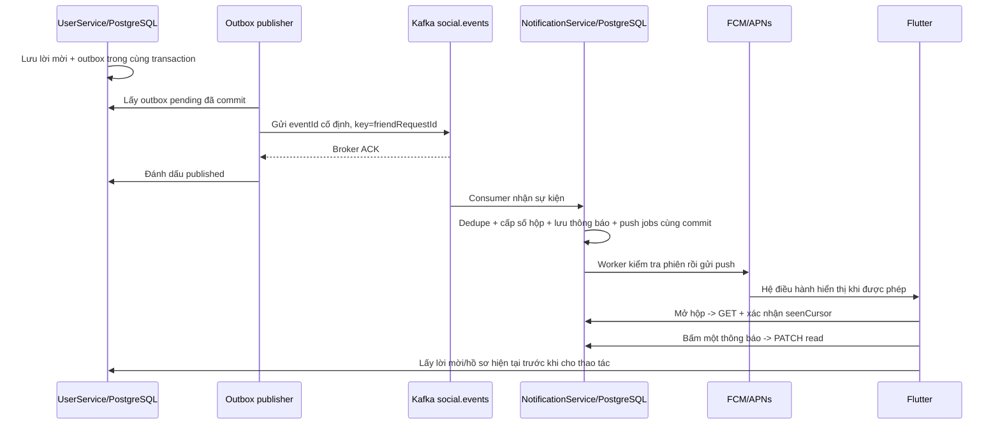

# NotificationService: thiết lập và học hệ thống

## 1. Đường đi của một thông báo

Outbox là bảng chờ gửi trong database UserService. Trigger AFTER INSERT/UPDATE trên
friend_requests ghi social_outbox trong cùng transaction nghiệp vụ. Chấp nhận lời mời
và tạo friendship rollback thì sự kiện cũng rollback. Không backfill thông báo từ lời
mời cũ lúc triển khai migration mới.

Publisher có thể dừng sau Kafka ACK nhưng trước published_at. Khi khởi động lại nó
sẽ gửi trùng: đây là hành vi được thiết kế, không phải Kafka chỉ giao một lần.
NotificationService dùng khóa (eventId,recipientId,type) để chỉ tạo một bản ghi.
Kafka offset chỉ được xác nhận sau xử lý; offset là vị trí đã đọc trong partition,
không phải ID thông báo, và cũng không phải lastSeen của người dùng.

## 2. Ba quy tắc lastSeen

- GET trả mốc 100; 101 đến trước PATCH. Flutter xác nhận 100 thì 101 vẫn mới.
- Máy B xác nhận 105 trước khi request mốc 100 của A tới: server giữ 105.
- Có 101/104/105 còn hạn chưa đọc, 102 đã đọc, 103 hết hạn: count=3, không phải 5.

Mốc được ký bởi server và ràng buộc người nhận/mục đích/thời hạn. Trang đầu và
latest_sequence được đọc trong một snapshot. Mỗi lần tạo thông báo phải cập nhật
cùng hàng inbox_state trước insert và giữ khóa tới commit: không thể commit số
mới hơn rồi sau đó một thông báo số nhỏ hơn mới xuất hiện. Chỉ dùng bigserial
mà không điều phối commit sẽ không bảo đảm điều này.

readAt ở từng dòng; lastSeen ở một hàng cho cả hộp. Đọc riêng push 105 không tự
đánh dấu 101-104 là đã xem. Mở hộp không tự làm các dòng thành đã đọc.

## 3. Chạy backend

1. `pnpm install` và `pnpm --filter @loccoc/common build`.
2. Tạo database notifications và role notification_service với mật khẩu riêng.
   Compose init hỗ trợ NOTIFICATION_DB_PASSWORD/NOTIFICATION_DB_NAME cho volume mới.
   Volume hiện có không chạy lại init: quản trị viên dùng psql để tạo role/database;
   không xóa volume để buộc chạy lại. Thu hồi CONNECT/PUBLIC theo chính sách triển khai.
3. Copy notification-service/.env.example sang .env tại đúng thư mục service.
   Điền NOTIFICATION_DB_PASSWORD, JWT_PUBLIC_KEY_PATH, INTERNAL_SERVICE_TOKEN chung
   với AuthService và NOTIFICATION_CURSOR_SECRET ngẫu nhiên ít nhất 32 ký tự.
   JWT key path tính từ notification-service; không sao chép private JWT key vào đây.
4. Chạy migration bằng TYPEORM_MIGRATIONS_RUN=true ở bước triển khai kiểm soát,
   sau đó tắt lại. UserService cần migration SocialOutbox1793318400000 trước khi
   bật publisher; migration chỉ tạo bảng/trigger và giữ dữ liệu nghiệp vụ cũ.
5. AuthService cần bản có endpoint nội bộ push-sessions; endpoint không đi qua Gateway.
6. Gateway cấu hình NOTIFICATION_SERVICE_URL=http://127.0.0.1:8084 rồi khởi động lại.
7. UserService/NotificationService dùng cùng SOCIAL_EVENTS_TOPIC=social.events và
   KAFKA_BROKERS. Tạo topic trước trong production, đặt retention/partition phù hợp;
   quyền producer chỉ cho UserService, consumer chỉ cho NotificationService.
8. `pnpm --filter user-service build`, `pnpm start:notification`, chạy lại các service
   đã đổi. Mỗi service đọc .env của chính nó. Chưa có FCM thì để FCM_ENABLED=false:
   hộp vẫn hoạt động, push jobs chờ và hết hạn đúng mốc.

KAFKA_SSL=true và KAFKA_SASL_USERNAME/PASSWORD bật TLS + SCRAM-SHA-256. Không dùng
plaintext trên mạng không tin cậy. Group mặc định notification-social-v1; nhiều
instance cùng group chia partition. Group khác có offset riêng. Không có thứ tự
toàn cục giữa các partition. Kafka là transport; UserService vẫn giữ trạng thái thật.

## 4. Thiết lập Firebase/Android/iOS

Cần Firebase project của chủ dự án. Chưa có thông tin này nên chưa gửi push thật.

- Đăng ký Android app đúng applicationId `com.example.mobile_app` và iOS app đúng
  bundle ID `com.example.mobileApp` (hoặc đổi đồng bộ app ID/Firebase/signing).
- Lấy FirebaseOptions công khai của từng nền tảng; chạy Flutter với Dart defines:
  FCM_ENABLED=true, FCM_API_KEY, FCM_APP_ID, FCM_SENDER_ID, FCM_PROJECT_ID và
  FCM_IOS_BUNDLE_ID trên iOS. FCM_APP_ID khác nhau giữa Android và iOS.
  Các giá trị này là cấu hình ứng dụng công khai, không phải service-account key.
- Client khởi tạo Firebase bằng options nên không bắt buộc thêm google-services
  Gradle plugin chỉ để sinh cấu hình. Nếu dùng FlutterFire CLI thay thế, giữ một
  nguồn FirebaseOptions nhất quán và kiểm tra lại cấu hình OAuth hiện có.
- Android đã khai báo POST_NOTIFICATIONS. Flutter xin quyền sau đăng nhập;
  cần Google Play services trên thiết bị/emulator hỗ trợ FCM.
- iOS đã có remote-notification background mode và aps-environment theo build
  configuration (Debug development; Release/Profile production). Trong Apple
  Developer/Xcode bật Push Notifications cho App ID, chọn provisioning profile
  hỗ trợ entitlement; tải APNs authentication key lên Firebase. Không đưa key vào Git.
- Server bật FCM_ENABLED=true và đặt GOOGLE_APPLICATION_CREDENTIALS thành đường
  dẫn tuyệt đối tới service-account JSON chỉ ở máy server, hoặc dùng workload ADC.
  Cấp quyền gửi FCM phù hợp. Không đưa file credential vào Flutter hay commit.
- Hiện Admin SDK 13 dùng registration token; Flutter giữ getToken/onTokenRefresh
  được SDK hỗ trợ nhưng đã deprecated. API FID/register mới là thay đổi hợp đồng
  client/server cần nâng đồng bộ; không gửi FID vào trường token của Admin SDK này.
- Login đăng ký installation + session; token đổi cập nhật đăng ký; logout gỡ trước
  khi thu hồi phiên. Server kiểm tra session còn hiệu lực trước khi gửi, nên logout
  vẫn ngăn lượt gửi mới khi bước gỡ đăng ký gặp lỗi. Một lượt gửi đã qua kiểm tra
  trước logout có thể hoàn tất. Push đã giao cho hệ điều hành không thể thu hồi chắc chắn.
- Push payload có recipientId. Chỉ điều hướng khi khớp tài khoản đang đăng nhập;
  mở từ trạng thái đóng được giữ đến lúc login vào đúng tài khoản.
- Không cấp quyền push thì hộp vẫn hoạt động. Notification payload do OS hiển thị
  khi app nền/đóng; khi foreground chỉ làm mới badge. Force-stop/giới hạn OS có thể
  ngăn giao. FCM accepted không đồng nghĩa delivered/opened/read.

## 5. Bài thực hành để hiểu Kafka/outbox

Dùng môi trường thử riêng, không dừng broker production.

1. Tắt broker thử, gửi lời mời A -> B. Kiểm tra friend_requests và social_outbox:
   nghiệp vụ thành công, published_at NULL; chưa có notification phía B.
2. Bật broker, chờ publisher. Xem social.events trong Kafbat; đối chiếu eventId,
   aggregateId, key, timestamp và recipientId. published_at có giá trị; B có 1 dòng.
3. Trên dữ liệu thử, đặt published_at về NULL rồi đợi phát lại. Kafka có thể có
   hai message cùng eventId nhưng notifications và push_jobs chỉ có một mỗi khóa.
4. Dừng consumer sau DB commit trước offset commit để mô phỏng crash; khởi động lại.
   Có thể nhận lại message, vẫn không thêm dòng trùng. Quan sát consumer lag giảm.
5. Mở hai thiết bị và gửi xác nhận cũ đến muộn: last_seen_sequence không lùi.
6. Phát payload hỏng vào topic thử: quarantine ghi topic/partition/offset, không
   lưu token/secrets/payload thô; consumer xử lý được message sau nó. Sửa producer,
   đọc offset qua Kafbat rồi replay bản đã sửa với quy trình kiểm soát.
7. Thử FCM token không hợp lệ, AuthService offline, phiên đã logout, thiết bị đổi
   tài khoản, offline trước/sau 24 giờ. Phân biệt retry với job kết thúc. Job retry
   có attempts/next_attempt_at; đạt 12 lần hoặc hết 24h thì dừng. Cảnh báo log là
   đầu vào giám sát; chưa tích hợp dịch vụ cảnh báo bên ngoài.
8. Replay sự kiện quá 90 ngày không tái tạo hộp; dedupe giữ 180 ngày. Inbox expiry
   tính từ ngày tạo; thời gian push luôn từ sự kiện, retry không làm mới hạn.

## 6. Kiểm chứng và giới hạn

Test database phải là database bỏ được: bộ integration tạo schema và TRUNCATE bảng.
NOTIFICATION_TEST_DB_URL trỏ PostgreSQL thử; NOTIFICATION_TEST_KAFKA_BROKERS bật test
Kafka thật với topic ngẫu nhiên tự dọn. Chạy `pnpm --filter notification-service test`.
Các bài push dùng provider mock; kiểm thử FCM/APNs trên Android/iOS thật vẫn cần
cấu hình chủ dự án. Chạy `flutter analyze`, `flutter test`, rồi thử foreground,
background, terminated, từ chối quyền, logout/đổi tài khoản và nhiều thiết bị.

Chính sách ẩn danh actor khi tài khoản bị xóa vẫn chưa chốt; không tự xóa snapshot
của người khác. API vẫn kiểm tra quyền/trạng thái hiện tại khi mở đích.

Nguồn chính thức:
- https://firebase.google.com/docs/cloud-messaging/flutter/get-started
- https://firebase.google.com/docs/cloud-messaging/flutter/receive-messages
- https://firebase.google.com/docs/cloud-messaging/customize-messages/setting-message-lifespan
- https://kafka.js.org/docs/consuming
- https://www.postgresql.org/docs/17/explicit-locking.html
